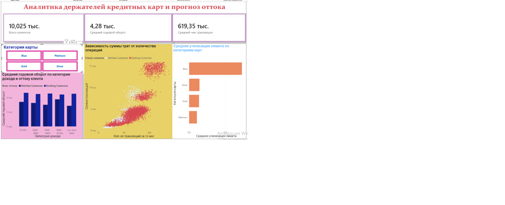

# 💳 Сквозной проект: Аналитика держателей банковских карт и прогноз трат (FinTech)

## ⚡ Executive Summary (Главные выводы)
1. **Профиль оттока:** Уровень оттока (Churn Rate) составляет **[16.2%]**. Ушедшие клиенты совершают значительно меньше транзакций и имеют статистически значимо более низкий медианный чек ($p < 0.0001$).
2. **Точность прогнозирования:** Модель линейной регрессии объясняет **[65,0%]** дисперсии годовых трат клиента ($R^2 = [0.650]$); главный драйвер оборота — частота транзакций (`total_trans_ct`).
3. **Утилизация лимита:** Клиенты с низким коэффициентом использования кредитного лимита находятся в основной зоне риска оттока.

---

## 📑 Оглавление
- [1. Постановка задачи и стейкхолдеры](#1-постановка-задачи-и-стейкхолдеры)
- [2. Структура репозитория](#2-структура-репозитория)
- [3. Ключевые результаты анализа](#3-ключевые-результаты-анализа)
- [4. Интерактивный дашборд](#4-интерактивный-дашборд)
- [5. Рекомендации для бизнеса (Action Plan)](#5-рекомендации-для-бизнеса-action-plan)

---

## 1. Постановка задачи и стейкхолдеры
* **Стейкхолдер:** Product Owner карточных продуктов.
* **Бизнес-проблема:** Отток активных держателей карт и недоиспользование одобренных кредитных лимитов.
* **Цель исследования:** Выявить поведенческие паттерны оттока, построить модель прогноза годовых трат клиента и проверить гипотезу о различии среднего чека.

---

## 2. Структура репозитория
* `fintech_analysis.ipynb` — полный код исследования (SQL-запрос, очистка, EDA, метрики, линейная регрессия, U-тест).
* `extract_fintech.sql` — SQL-запрос с использованием CTE и оконных функций (`OVER PARTITION BY`).
* `requirements.txt` — список зависимостей с версиями библиотек.
* `.gitignore` и `LICENSE` — конфигурация репозитория и лицензия MIT.

---

## 3. Ключевые результаты анализа
* **Предобработка:** Из `[10127]` записей после удаления выбросов (выше 99-го перцентиля) сохранено `99.0%` данных.
* **Модель прогнозирования (Linear Regression):** Точность на тесте **$R^2 = [0.650]$**, средняя абсолютная ошибка **MAE = $[1374.64]$ USD**.
* **Проверка гипотез:** По результатам U-теста Манна-Уитни различие медианного чека активных (**[55.73] USD**) и ушедших клиентов (**[54.95] USD**) статистически значимо (`p-value < 0.0001`).

---

## 4. Интерактивный дашборд

---

## 5. Рекомендации для бизнеса (Action Plan)
1. **Триггерная система удержания (Anti-Churn):** Настроить автоматический мониторинг частоты операций — при падении числа транзакций клиента ниже 40 в год предлагать персональный повышенный кэшбэк на повседневные категории.
2. **Стимулирование утилизации кредитного лимита:** Запустить беспроцентный грейс-период или бонусные баллы за первую крупную покупку для держателей карт с утилизацией лимита менее 10%.
3. **Апселл премиальных сегментов:** Переводить клиентов категории `Blue` с высоким годовым оборотом и стабильной платежной дисциплиной на карты `Silver`/`Gold` для повышения удержания.
